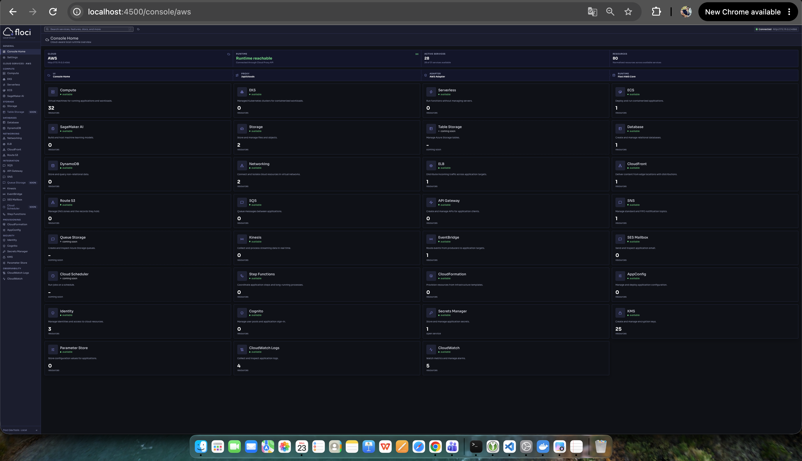
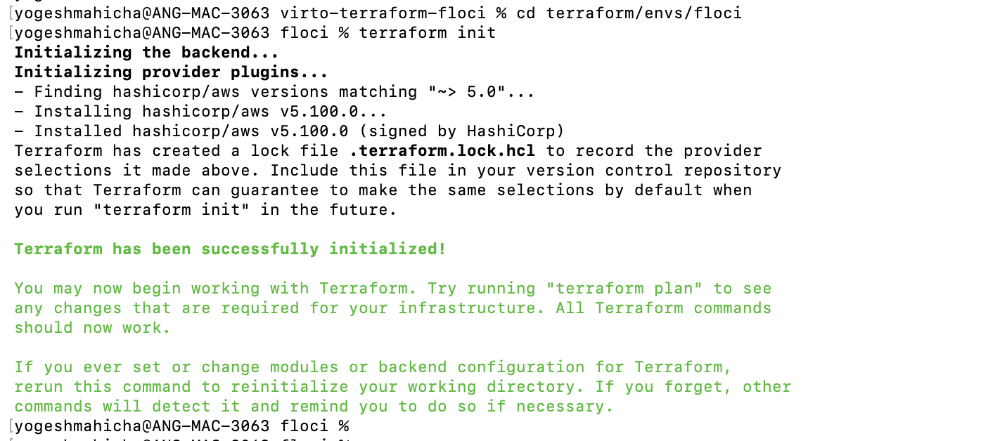
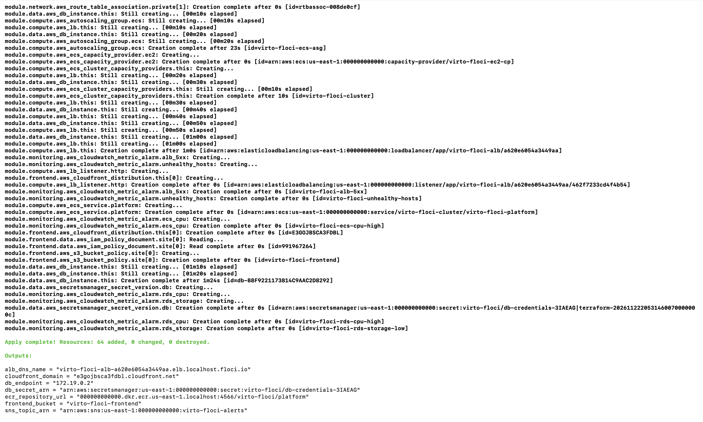
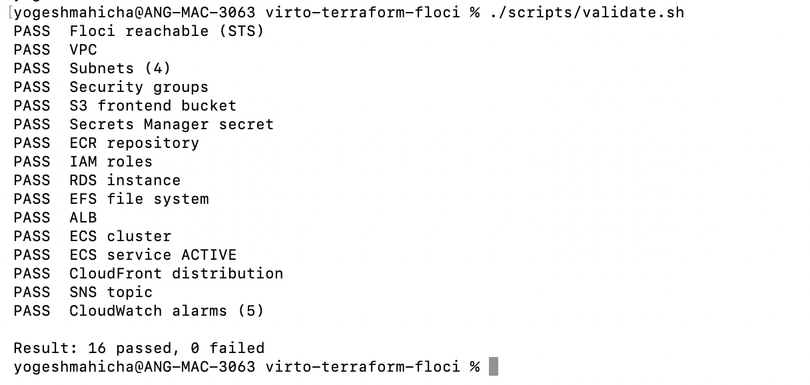

# Virto Commerce on AWS (Terraform + Floci)

Terraform code that builds the AWS architecture for Virto Commerce on the **Floci emulator**.

> Nothing is deployed to real AWS. This is tested only on Floci (a local emulator).

## What gets created

| Module | Resources |
|---|---|
| network | VPC, public/private subnets, NAT, security groups |
| data | RDS PostgreSQL, Secrets Manager, EFS |
| compute | ECR, IAM roles, ALB, ECS on EC2 (ASG) |
| frontend | S3 (private) + CloudFront |
| monitoring | SNS + 5 CloudWatch alarms |

## Structure

```
floci/        Floci docker-compose + env.sh
scripts/      floci-up.sh, validate.sh, floci-down.sh
terraform/
  envs/floci/ Floci-specific settings
  modules/    network, data, compute, frontend, monitoring
images/       screenshots
```

## How to run

Prerequisites: Docker, Terraform, AWS CLI

```bash
./scripts/floci-up.sh      # start Floci and create all resources
./scripts/validate.sh      # check 16 resources
./scripts/floci-down.sh    # destroy everything and stop Floci
```

| Script | Purpose |
|---|---|
| `floci-up.sh` | Starts Floci, then runs `terraform apply` |
| `validate.sh` | Uses the AWS CLI to check that resources exist (PASS/FAIL) |
| `floci-down.sh` | Runs `terraform destroy` and stops Floci. If destroy fails, it resets Floci |

## Screenshots






## Limitations

- The Virto app does not run on the emulated ECS (`desired_count = 0`, no image in ECR).
- CloudFront is created on Floci, but its domain does not serve traffic.
- VPC destroy sometimes hangs on Floci; the script has a fallback reset.
- CI/CD and the real AWS config (`envs/aws`) are not done yet.
